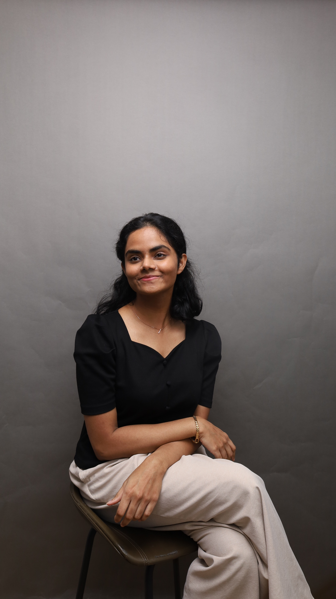
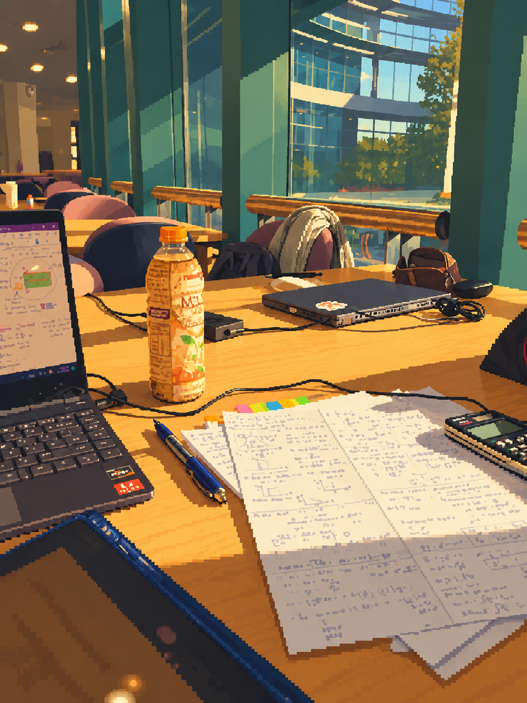

::: {.hero}
::: {.hero-introduction}

Economics Researcher @ NTU Singapore

I explore the intersection of AI, behavioural economics, and wellbeing.

:::

::: {.hero-identity}

Hello, I'm

::: {.hero-portrait}

<h1 id="hero-title" class="hero-name">Kavishni.</h1>
:::
:::
:::

::: {.hero-welcome}
Welcome to my corner of the web. Do scroll down to check out my portfolio. [\[Writing\]](https://kavishni.substack.com/) and [\[Vitae\]](cv.pdf) link out to my Substack and CV respectively. If you have more time to explore, head over to my [\[Digital Garden\]](digital-garden.qmd) to decompress and have some fun.
:::

## About Me {#about}

::: {.about-intro-grid}
::: {.about-intro-column}
Hi again! My name is Kavishni (pronounced KAH-vish-nee). I'm a Research Assistant with NTU School of Social Sciences. My research is advised by Prof Nick Powdthavee & Assoc Prof Wang Wenjie.

I'm interested in the [human] side of
things; how AI, economics and other fun stuff impact our [human] behaviour,
decision-making and wellbeing.

Before this, I worked in Biomechanics R&D at NTU School of Mechanical and Aerospace Engineering. I designed, optimized and tested biomechanical devices to aid SG Orthopedic surgeons better the lives of their patients.

:::

::: {.about-intro-column}
I graduated from the NTU double degree program in Mechanical Engineering and Economics. Back then I have explored a number of industries by interning as an engineer at a biomedical startup, a product manager at a B2B fintech firm, and doing PEP research at LSEG WorldCheck.

#### Education

- Bachelor of Engineering (Honours) in Mechanical Engineering, NTU
- Bachelor of Social Sciences (Honours) in Economics, NTU

I'm originally from Sri Lanka, now based in Singapore. Outside of work, I love tending to my digital garden, volunteering, writing, public speaking, and
building communities that bring people together.
:::
:::

::: {.research-writing-grid}

::: {.research-column}
## Research {#research}

::: {.research-visual}

Sunlit study spot in NIE library, NTU SG

Something is brewing here... Check back later :)

:::

:::

::: {.speaking-column}
## Speaking {#speaking}

::: {.editorial-list .speaking-list}
I've been developing my public speaking skills recently! Here are some of my recent events.

<table class="speaking-table">
<tbody>
<tr><td>Sep 2026</td><td>Moderator/Event Host</td><td>WoMAEn in Dialogue: Lead with Confidence series #2</td></tr>
<tr><td>Aug 2026</td><td>Panel Moderator/Event Host</td><td>ResearcHER Connect with MathWorks</td></tr>
<tr><td>Jun 2026</td><td>Event Co-host</td><td>Generalist World SG Event</td></tr>
<tr><td>Mar 2026</td><td>Moderator/Event Host</td><td>WoMAEn in Dialogue: Lead with Confidence series #1</td></tr>
<tr><td>Feb 2026</td><td>Event Co-host</td><td>Generalist World SG Event</td></tr>
</tbody>
</table>

Do reach out to me via [\[LinkedIn\]](https://www.linkedin.com/in/kavishni/) if you'd like to have me as your host.
:::

:::

:::

<!-- Selected writing is omitted because content/writing.md has no entries. -->

